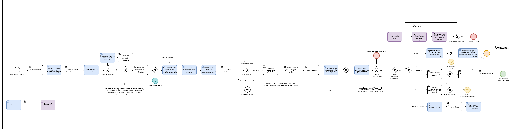
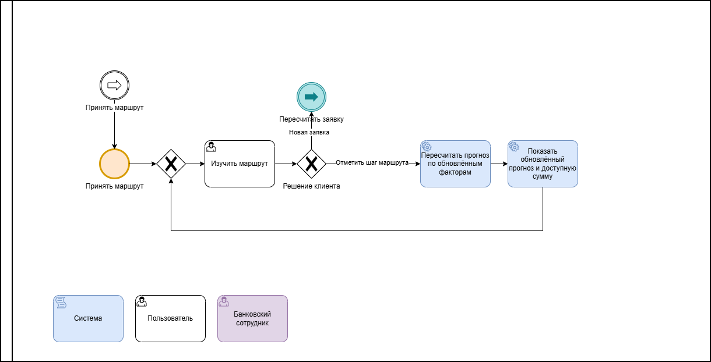

# Бизнес-процесс «Маршрут к одобрению»

От задачи предпринимателя до денег на счёте или до понятного плана, как к ним прийти.

**Схема BPMN:** две страницы: «Процесс» — от входа в кабинет до решения банка, «Маршрут» — работа клиента с шагами после отказа или до подачи.

**Страница «Процесс»**

**Страница «Маршрут»**

---

## 1. Коротко

Предприниматель описывает задачу своими словами. До подачи заявки он видит шанс одобрения, доступную сумму, стоимость в рублях и причины. После подачи банк проверяет заявку и выносит решение **по правилам, автоматически**. Кредитный специалист подключается только в заранее определённых случаях.

Решение небинарно. Возможные исходы: одобрено, иные условия, нужны данные, отказ, приостановка по 115-ФЗ. При отказе и при иных условиях клиент получает **маршрут к одобрению**: что мешает, какие шаги сделать, за какой срок и какой прогноз получится после них. Маршрут можно открыть и до подачи — по данным предоценки.

## 2. Участники

| Участник | Роль в процессе |
|---|---|
| **Клиент** — ИП или микро-ООО, где владелец = директор = поручитель | Описывает задачу, подтверждает данные, выбирает вариант, отправляет заявку, принимает решение по предложению, выполняет шаги маршрута |
| **Система** — кабинет и движок одобрения | Подтягивает данные компании, считает предоценку и варианты, проверяет заявку, выносит решение, строит и пересчитывает маршрут |
| **Кредитный специалист** | Разбирает только заявки-исключения: видит причину попадания и рекомендацию системы, подтверждает или меняет исход с кодом причины |

## 3. Принципы

1. **Решение принимают правила, а не языковая модель.** Модель только разбирает фразу клиента и пересказывает уже посчитанные факты. Все пороги и формулы лежат в `ml/config/policy.yaml`.
2. **По умолчанию решение без человека.** К специалисту уходят только исключения (раздел 7).
3. **Честно до подачи.** Предоценка не запрашивает БКИ и не портит кредитную историю. Данные о владельце берутся со слов клиента, и это помечено на экране.
4. **Некредитный стоп отделён от кредитного отказа.** Приостановка по 115-ФЗ — отдельный исход, маршрут при ней не строится.
5. **Ничего не теряется.** Данные сохраняются на каждом шаге (раздел 8).

## 4. Этапы процесса

### 4.1. Задача клиента — экран «Цель»

| Кто | Что происходит |
|---|---|
| Клиент | Входит в кабинет по демо-аккаунту, без регистрации |
| Клиент | Описывает задачу своими словами, например «нужно 850 тыс. на закупку к сезону» |
| Система | Распознаёт сумму, срок и цель, предлагает продукт: оборотный кредит или овердрафт («запас на месяц» → овердрафт) |
| Клиент | Проверяет распознанные поля, исправляет их при необходимости и подтверждает продукт |

💾 Данные сохраняются в черновик заявки (статус `DRAFT`).

### 4.2. Компания — экран «Компания»

| Кто | Что происходит |
|---|---|
| Система | Находит компанию по ИНН и подтягивает ОКВЭД, возраст бизнеса, обороты по счёту за 6 месяцев, срок обслуживания счёта, долг бизнеса, данные ФНС, ФССП и судов |
| ◇ | **Компания найдена?** Да → дальше. Нет → система сообщает «компания не найдена», клиент заполняет данные вручную. В MVP компания всегда найдена: одна учётная запись — одна компания из реестра |

💾 Данные сохраняются в черновик.

### 4.3. Данные для расчёта — экран «Финансы»

| Кто | Что происходит |
|---|---|
| Клиент | Указывает выручку и отвечает на два вопроса о себе: просрочки за 2 года, включая закрытые; личные платежи по кредитам и кредиткам в месяц. Загрузку кредитных карт система узнаёт из БКИ после подачи |
| Система | Помечает ответы о владельце «со слов клиента, проверим после подачи» |

💾 Данные сохраняются в черновик.

### 4.4. Предоценка и выбор варианта — экран «Предложение»

| Кто | Что происходит |
|---|---|
| Система | Считает оценку по 9 факторам слоёв «бизнес» и «владелец», проверяет стоп-факторы, считает лимит по формуле выбранного продукта |
| Система | Показывает шанс (высокий, средний или низкий), вилку доступной суммы, стоимость в рублях, причины и подсказки «что исправить». Подпись: «Это оценка по текущим данным, а не решение банка. Действует 30 дней» |
| Система | Формирует варианты: запрошенная сумма, сумма в пределах оценки, другой срок, другой продукт. У каждого — платёж и полная стоимость |
| Клиент | Выбирает вариант |
| ◇ | **Решение клиента:** • **Продолжить** → документы и отправка • **Изменить сумму, срок или данные** → пересчёт предоценки • **Открыть маршрут без подачи** → маршрут без заявки и без запроса в БКИ |

Экран один для всех клиентов, меняется только содержание:
- **высокий шанс** — сумма в пределах оценки;
- **средний** — сумма выше оценки, предложен вариант в пределах;
- **низкий из-за стоп-фактора** — система прямо говорит, что уменьшение суммы не поможет;
- **банк видит не весь оборот** — подсказка приложить выписку второго банка.

💾 Предоценка сохраняется вместе с черновиком и действует 30 дней.

### 4.5. Документы и отправка — экраны «Документы» и «Отправка»

| Кто | Что происходит |
|---|---|
| Клиент | Загружает только недостающие документы. Клиенту с расчётным счётом в банке ничего загружать не нужно. При расхождении оборота можно приложить выписку второго банка: проверка её учтёт |
| Клиент | Проверяет сводку и даёт два согласия: на запрос в БКИ и на обработку данных. Без согласий отправить заявку нельзя |
| Клиент | Отправляет заявку |
| Система | Регистрирует заявку: `DRAFT` → `SUBMITTED` → `IN_REVIEW`. Клиент видит ленту этапов проверки, срок решения не обещается |

💾 С этого момента каждое изменение статуса пишется в журнал событий заявки.

### 4.6. Автоматическая проверка банком — экран «Статус»

| Кто | Что происходит |
|---|---|
| Система | **Б1–Б2**: проверка полноты, сверка заявленной выручки с оборотом по счёту, запрос БКИ владельца и уровня риска по 115-ФЗ |
| ◇ | **Риск по 115-ФЗ красный?** Да → `SUSPENDED_115FZ`, процесс завершён. Клиент видит шаблонный текст «это не оценка кредитоспособности» и порядок пересмотра. Маршрут не строится |
| Система | **Б3–Б4**: оценка на проверенных данных (БКИ вместо слов клиента) и решение по правилам |
| ◇ | **Нужен кредитный специалист?** Да → разбор специалистом (4.7). Нет → исход решения (раздел 5) |

### 4.7. Разбор специалистом — экран «Банк»

| Кто | Что происходит |
|---|---|
| Клиент | Видит «Заявку рассматривает специалист» (`SPECIALIST_REVIEW`), срок не называется. До решения может отозвать заявку → `WITHDRAWN` |
| Специалист | Берёт заявку из очереди. Причина попадания видна в очереди |
| Специалист | Изучает досье: оценку по факторам, компоненты лимита, проверки и рекомендацию системы |
| Специалист | Подтверждает рекомендацию или выбирает другой исход: одобрить, иные условия, запросить данные, отказать. Код причины из справочника обязателен, без него решение не сохраняется. Действие пишется в журнал |

Дальше заявка идёт по тем же исходам, что и при автоматическом решении (раздел 5).

## 5. Исходы решения

| Исход | Когда | Что видит клиент | Что дальше |
|---|---|---|---|
| **Одобрено** (`APPROVED`) | 70+ баллов, сумма в пределах лимита | Сумма, ставка, платёж, полная стоимость | Принять условия (`OFFER_ACCEPTED`) → подписать договор (`SIGNED`) → деньги на счёте (`DISBURSED`) |
| **Иные условия** (`COUNTER_OFFER`) | Сумма выше лимита или 50–69 баллов | «Хотели X — можем Y» и что ограничивает сумму | **Согласиться** → как при одобрении. Изменить срок в пределах предложения — доработка (раздел 10). **Посмотреть, что держит сумму** → маршрут доступен сразу, предложение остаётся в силе. **Отказаться** → `DECLINED_BY_CLIENT`, маршрут сохраняется |
| **Нужны данные** (`INFO_REQUESTED`) | Заявленная выручка выше оборота по счёту больше чем на 30%, или не хватает документа | Какой документ нужен | Клиент загружает документ **в ту же заявку**, проверка запускается заново. Новой заявки и нового запроса в БКИ нет |
| **Отказ** (`REJECTED`) | Стоп-фактор или недостаточная оценка | Причины простыми словами, первая — главная; ближайшая альтернатива — прогноз маршрута: какая сумма станет доступна после шагов | Система строит и сохраняет маршрут (раздел 6) |
| **Приостановлена** (`SUSPENDED_115FZ`) | Красный уровень риска по 115-ФЗ | «Это не кредитный отказ», порядок пересмотра | Маршрут не строится |

## 6. Маршрут к одобрению (страница схемы «Маршрут»)

В интерфейсе маршрут — панель «Маршрут к вершине» на главной «Гора»; на экране статуса — карточка «Следующий привал» с переходом на главную. Страницы и состояния — в [`route-pages.md`](../05-ux/route-pages.md).

Как клиент попадает в маршрут:
- после отказа;
- при иных условиях — сразу, пока предложение в силе, и после отказа от них;
- до подачи, по кнопке «Открыть маршрут без подачи».

| Кто | Что происходит |
|---|---|
| Система | Определяет, что держит результат: стоп-фактор, оценка, лимит (оборот, долг, платёж) или временное окно. Строит шаги: действие, срок, вклад в оценку или лимит. Стоп-фактор всегда первый шаг: он не добавляет баллов, но без него маршрут не двигается |
| Клиент | Изучает маршрут: что мешает, шаги, горизонт, прогноз |
| ◇ | **Решение клиента:** • **Отметить шаг выполненным** → система пересчитывает прогноз и показывает новую доступную сумму. Пересчёт не создаёт заявку и не обращается в БКИ; задержка обновления БКИ — 2 рабочих дня • **Новая заявка** → новый черновик, процесс начинается с предоценки |

**Если держит временное окно**, например просрочка 90+ дней за последние 12 месяцев, ускоряющих шагов нет: первый шаг — «Дождаться» без отметки. Клиент видит срок «~N мес., ускорить нельзя», что делать сейчас и чего не делать: например, не рассылать заявки в другие банки.

**Если баллов хватает, а лимит меньше запрошенной суммы** (P3 после всех шагов), маршрут показывает доступную сумму и что держит остальное. «Готов к подаче» появляется, когда выбранная сумма не больше лимита.

💾 Маршрут сохраняется при первом открытии. Отмеченные шаги сохраняются и показываются при следующем входе.

## 7. Когда заявку разбирает специалист

**Сейчас в коде** (`ml/service/decision.py`, `backend/app/services/pipeline.py`):

| Триггер | Условие | Срабатывает в MVP |
|---|---|---|
| `AMOUNT_ABOVE_2M` | Запрошенная сумма больше 2 млн ₽ | Да (P2) |
| `BORDERLINE_SCORE` | Оценка 50–59 баллов без стоп-факторов | Да |
| `MISMATCH_UNRESOLVED` | Расхождение по обороту не снято после загрузки выписки | Нет: в движке есть, но загрузка выписки снимает расхождение |
| `CLIENT_DISPUTE` | Клиент оспорил решение | Нет: в движке есть, кнопки оспаривания нет |
| `ML_UNAVAILABLE` | Движок одобрения недоступен после трёх попыток | Да |

**Цель — максимум решений без человека.** Предлагается сузить разбор до настоящих исключений:
- иные условия для суммы больше 2 млн, если её держит формула оборота;
- иные условия для оценки 50–59: в политике для них уже есть автоправило — 50% лимита и +4 п.п. к ставке;
- решение по подтверждённому обороту вместо специалиста, если расхождение не снято.
Специалист остаётся для зоны 3–5 млн с поручителем, антифрод-расхождений реквизитов, оспаривания и недоступности источников. Это требует правки `policy.yaml` и `decision.py`.

## 8. Сохранение данных

| Что | Когда сохраняется | Что это даёт клиенту |
|---|---|---|
| Черновик заявки | При переходе на каждый следующий шаг: цель, компания, финансы, предложение, документы | Можно выйти и вернуться: черновик открывается с заполненными данными |
| Предоценка | При расчёте на шаге «Предложение» | Действует 30 дней; пересчёт — повторным нажатием «Показать предложения» |
| Документы | При загрузке, в черновик или в заявку по запросу банка | Дозагрузка идёт в ту же заявку, без повторного ввода |
| Статусы и решения | При каждом переходе статуса — в журнал событий | Клиент видит историю на экране статуса, специалист — журнал действий |
| Маршрут и отмеченные шаги | При первом открытии и при каждом пересчёте | Прогресс по маршруту не теряется между входами |

## 9. Покрытие тестовых сценариев

Персоны из [test-user-maps.md](../06-personas/test-user-maps.md):

| Персона | Путь по схеме | Ожидаемый итог |
|---|---|---|
| **P1** Ольга, кофейня, 850 тыс. | Предоценка «высокий» → подача → автоматическое одобрение → принять → подписать | `DISBURSED` |
| **P2** ООО «Полка», 3 млн | Подача → специалист по сумме → иные условия 2,85 млн → принять или отказаться и получить маршрут по обороту | `COUNTER_OFFER` |
| **P3** Тимур, автосервис, налоговый долг | Предоценка «низкий» → подача → отказ → маршрут из трёх шагов → пересчёт → прогноз 1,1 млн → новая заявка → иные условия 1,1 млн | `REJECTED` → маршрут → `COUNTER_OFFER` |
| **P4** Марина, просрочка 90+ | Предоценка по словам клиента → после БКИ отказ → маршрут «~8 мес., ускорить нельзя» | `REJECTED`, временное окно |
| **P5** Андрей, овердрафт | Выбор овердрафта → нужны данные → выписка в ту же заявку → одобрено | `INFO_REQUESTED` → `APPROVED` |
| **ZSK** | Подача → приостановка по 115-ФЗ, маршрута нет | `SUSPENDED_115FZ` |
| **P6** Ирина, бухгалтер | Не в MVP | — |

## 10. Есть на схеме, но в приложении пока нет или есть частично

Состояние на 24.10.2026.

| Что | Статус |
|---|---|
| Кнопка «Открыть маршрут без подачи» | Сделано: кнопка на шаге «Предложение», маршрут по черновику без БКИ |
| Порог «Готов к подаче»: нет стопов, 70+ баллов, лимит не меньше суммы | В панели маршрута — сделано. На экране статуса кнопка «Новая заявка» доступна всегда |
| Закрытие предложений через 30 дней и запросов данных через 14 дней | Сделано: заявка истекает при первом открытии после срока. У принятого, но не подписанного предложения срока нет |
| Изменить срок в пределах иных условий | Бэкенд принимает срок, в интерфейсе выбора срока нет |
| Подтверждение предупреждения перед подачей при низком шансе | Нет: только пометка «Шансы низкие · можно отправить на проверку» |
| «Не согласен с причиной» (оспаривание) | Триггер в движке есть, кнопки нет |
| Отказ клиента от одобренного предложения | Отклонить можно только иные условия |
| Сужение триггеров специалиста (раздел 7) | Нужна правка политики и движка |

## Связанные документы

- [product-concept.md](../02-product/product-concept.md) — смысл продукта
- [mvp-scope.md](../02-product/mvp-scope.md) — границы MVP
- [business-rules.md](../03-requirements/business-rules.md) — правила решения BR-01…BR-16
- [user-stories.md](../03-requirements/user-stories.md) — пользовательские истории
- [use-cases.md](../03-requirements/use-cases.md) — варианты использования
- [test-user-maps.md](../06-personas/test-user-maps.md) — тестовые персоны и ожидаемые результаты
- [route-pages.md](../05-ux/route-pages.md) — страницы и состояния маршрута
- [architecture.md](../architecture.md) — компоненты системы и диаграмма состояний заявки
- `ml/config/policy.yaml` — пороги, формулы и правила решения
