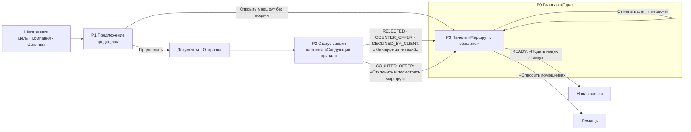

# Экраны маршрута к одобрению

Где клиент видит маршрут, откуда на него попадает и что на нём показывается. Документ дополняет [BPMN-процесс](../04-process/bpmn-description.md) (страница схемы «Маршрут»), правило [BR-12](../03-requirements/business-rules.md) и [карты персон](../06-personas/test-user-maps.md). Статусы и коды — как в коде: `backend/app/schemas/applications.py`, `ml/service/route.py`, `ml/config/reasons.yaml`.

**Решение.** Отдельной страницы маршрута нет: маршрут — панель «Маршрут к вершине» на главной «Гора». Все ссылки на маршрут открывают главную с этой панелью, адрес `/route` тоже ведёт туда. На экране статуса заявки — только карточка «Следующий привал» с переходом на главную. Так маршрут живёт там же, где образ горы, а экраны заявки не перегружаются.

---

## 1. Как связаны экраны

| № | Экран | Что на нём связано с маршрутом |
|---|---|---|
| Р0 | Главная «Гора» | Альпинист на тропе: высота — доступная сумма, вершина — запрошенная. Под горой — карточки «Высота», «Вершина», «Варианты маршрута» и полоса «Условия пути». Стрелка «›» на карточке «Варианты маршрута» открывает сводку «Мой маршрут» с кнопкой «Открыть маршрут» |
| Р1 | Шаг «Предложение» (предоценка) | Блок «Что влияет на решение и как это исправить»; кнопка «Открыть маршрут без подачи» |
| Р2 | Статус заявки | Карточка «Следующий привал»: ориентир по сроку и кнопка «Маршрут на главной». Шагов маршрута на статусе нет |
| Р3 | Панель «Маршрут к вершине» на главной | Разделы: где вы · что сделать (отметки и пересчёт) · ориентир · чего не делать · действия (`frontend/src/components/RoutePanel.tsx`) |
| — | Помощь | Подсказки-вопросы по заявке и маршруту |

---

## 2. Откуда ведут ссылки на маршрут

| Откуда | Элемент | Когда показывается | Куда |
|---|---|---|---|
| Р1 Предложение | Кнопка «Открыть маршрут без подачи» | Шанс не высокий или сумма выше оценки. При стоп-факторе — основное действие вместо «Продолжить» | Р3, маршрут по черновику, заявка не подаётся |
| Р2 Статус, `REJECTED` | «Маршрут на главной» в карточке «Следующий привал» | Всегда при отказе, кроме постоянного стоп-фактора | Р3, маршрут от решения |
| Р2 Статус, `COUNTER_OFFER` | «Маршрут на главной» в карточке «Следующий привал» | Пока предложение действует; предложение остаётся в силе | Р3, что держит сумму |
| Р2 Статус, `COUNTER_OFFER` | Кнопка «Отклонить и посмотреть маршрут» | Пока предложение действует | Статус `DECLINED_BY_CLIENT`, затем Р3 |
| Р2 Статус, `DECLINED_BY_CLIENT` | «Маршрут на главной» | Всегда | Р3 |
| Р0 Главная | Карточка «Варианты маршрута» → «›» → «Открыть маршрут» | У текущей заявки есть маршрут | Р3 |

**Где ссылки на маршрут нет:**
- `APPROVED`, `OFFER_ACCEPTED`, `SIGNED`, `DISBURSED`: ограничений нет.
- `INFO_REQUESTED`: вместо маршрута — что загрузить и до какого срока.
- `SUSPENDED_115FZ`: некредитная причина. Вместо маршрута — блок «Что делать дальше · процедура 115-ФЗ».
- `WITHDRAWN`, `EXPIRED`: решения банка не было или срок истёк.
- `SUBMITTED`, `IN_REVIEW`, `SPECIALIST_REVIEW`: решение ещё не принято.

---

## 3. Р3 «Маршрут к вершине» — что в панели

Гора — это сама главная: альпинист на тропе, высота и вершина. Панель справа содержит разделы ниже.

| Блок | Что показывает | Данные |
|---|---|---|
| 1. Шапка | «Маршрут к вершине» и основание: «по предварительной оценке», «по решению банка» или «по решению специалиста банка» | Черновик или поданная заявка; `basedOn`: `SYSTEM` / `SPECIALIST` |
| 2. Где вы | Сколько пути пройдено: доступная сейчас сумма относительно вершины | Текущая высота: решение банка, а для черновика — верх вилки предоценки. Вершина: запрошенная сумма |
| 3. Что сделать | Шаги с отметками: действие, срок, цвет, вклад в баллы. У шагов, которые меняют кредитную историю, — «бюро обновит данные за 2 рабочих дня». У шага по обороту — целевой оборот в месяц | `steps[]`: `action`, `term`, `pointsGain`, `done`, `bkiDelayBusinessDays`, `targetTurnover` |
| 4. Ориентир | Горизонт: «~3 мес.», «~8 мес., ускорить нельзя», «срок зависит от темпа роста оборота»; сумма после всех шагов; подпись дословно: «Это ориентир при текущем темпе, а не обещание одобрения.» | `horizonText`, `projectedAmount`, `disclaimer` |
| 5. Чего не делать | Предупреждения, например «Не подавайте заявки в другие банки — каждая заявка видна в кредитной истории и снижает рейтинг на 2–3 месяца» | `advice[]` |
| 6. Действия | «Подать новую заявку» — только при `READY`. «Спросить помощника» — всегда | `status` |

Цвета причин и шагов: 🟢 можно сразу · 🟡 нужно время · 🔴 стоп-фактор.

**Поведение:**
- Отметка шага сразу пересчитывает маршрут той же моделью. Выполненные шаги остаются в списке зачёркнутыми, ориентир, прогноз и положение альпиниста обновляются.
- Пересчёт не создаёт заявку и не обращается в бюро кредитных историй.
- Маршрут и отметки сохраняются: при следующем входе клиент видит свой прогресс.

---

## 4. Варианты маршрута по тому, что держит результат

| `holds` | Пример | Что в панели |
|---|---|---|
| `STOP` | P3, налоговый долг | Стоп-фактор — первый шаг, вклад «+0, без него маршрут не двигается». Дальше шаги с баллами. Ориентир «~3 мес.» |
| `SCORE` | Не хватает баллов, стопов нет | Шаги с вкладом в баллы, прогноз баллов и суммы |
| `TURNOVER` | P2, иные условия | Один шаг «рост оборота до 2 000 000 ₽ в месяц» и пометка «баллы уже не мешают — сумму держит оборот» |
| `TIME_WINDOW` | P4, просрочка 90+ за 12 месяцев | «~8 мес., ускорить нельзя». Шаг «дождаться» без отметки, затем что делать сейчас и чего не делать. Без игровых элементов и анимации: альпинист на главной стоит у подножия |
| `STOP_PERMANENT` | Ликвидация, банкротство, отрасль не кредитуется | «Маршрута нет»: причина и предложение подобрать другой вариант. Кнопки «Подать новую заявку» нет |
| `NONE` | Маршрут дошёл до цели | Статус `READY`, «Можно подавать заявку» |
| `NONCREDIT` | ZSK, 115-ФЗ | В панель не попадают: ссылки нет |

---

## 5. Состояния маршрута

| Статус маршрута | Когда | Что видит клиент |
|---|---|---|
| `ACTIVE` | Маршрут построен, порог не достигнут | Шаги, отметки, пересчёт. Кнопки «Подать новую заявку» нет |
| `READY` | Нет стоп-факторов, 70+ баллов, лимит не меньше выбранной суммы (BR-13) | «Готов к подаче» и кнопка «Подать новую заявку»: новый черновик с данными маршрута |
| `NO_ROUTE` | 115-ФЗ или постоянный стоп-фактор | При 115-ФЗ — процедура на экране статуса; при постоянном стопе — «Маршрута нет» с причиной |

---

## 6. Маршрут без подачи и маршрут после решения

| | Без подачи (из Р1) | После решения (из Р2) |
|---|---|---|
| Заявка | Остаётся черновиком `DRAFT` | Есть решение: `REJECTED`, `COUNTER_OFFER` или `DECLINED_BY_CLIENT` |
| Данные о владельце | Со слов клиента, пометка «кредитную историю проверим после подачи» | Данные бюро кредитных историй |
| Запрос в бюро | Нет | Был при подаче |
| Основание в шапке | «По предварительной оценке» | «По решению банка» или «По решению специалиста банка» |

Для черновика `POST /applications/{id}/route` собирает данные как для предоценки: ответы клиента, без бюро и ЗСК. При новой предоценке и при подаче маршрут черновика сбрасывается и после решения строится заново. Выполненные шаги сохраняются в маршруте.

---

## 7. Путь персон по экранам

| Персона | Путь |
|---|---|
| P1 | Р1 → Отправка → Р2 `APPROVED`. Маршрута нет |
| P2 | Р1 → Отправка → Р2 `SPECIALIST_REVIEW` → `COUNTER_OFFER` → «Маршрут на главной» или «Отклонить и посмотреть маршрут» → Р3 `TURNOVER` |
| P3 | Р1 «низкий» → «Открыть маршрут без подачи» → Р3 `STOP`; или подача → Р2 `REJECTED` → Р3. Отметка шагов → `READY` → новая заявка |
| P4 | Р1 «средний» по словам клиента → Отправка → Р2 `REJECTED` → Р3 `TIME_WINDOW` |
| P5 | Р2 `INFO_REQUESTED` → загрузка выписки → `APPROVED`. Маршрута нет |
| ZSK | Р2 `SUSPENDED_115FZ` → процедура 115-ФЗ. Маршрута нет |

---

## 8. Статистика продукта

Эффект продукта показывается в кабинете администратора банка (US-38, UC-11, `GET /admin/stats`), а не клиенту на главной.

**Чего не делаем.**
- Не показываем клиенту цифры вида «с нами одобряют на X% чаще» или «быстрее на Y%». На синтетических данных такие числа ничего не доказывают, а обещать одобрение и срок решения банка нельзя (BR-01, BR-15).
- Не выбираем метрики по тому, нравится ли результат: каждая считается по всем заявкам одинаково.

**Что считаем — только из событий в базе** (таблица `application_events`, статусы и время):

| Метрика | Как считается | Зачем банку |
|---|---|---|
| Воронка | Черновики → поданные → решения → выданные | Где теряются клиенты |
| Исходы | Доли одобрено / иные условия / нужны данные / отказ / 115-ФЗ | Структура решений |
| Доля автоматических решений | Решения без специалиста / все решения | Снижение ручной работы |
| Время заполнения | Медиана от создания черновика до подачи | Проверка гипотезы Г5 «около 5 минут» |
| Время до решения | Медиана от подачи до решения | Скорость процесса |
| Топ причин отказа | Частота кодов причин в решениях | Что чаще всего мешает клиентам |
| Возврат по маршруту | Доля отказников, у которых маршрут дошёл до `READY` или есть новая заявка | Удержание клиента после отказа (Г2) |
| Предоценка ↔ решение | Доля заявок, где ожидаемый исход предоценки совпал с решением | Честность предоценки |

Клиенту из этого блока можно показывать одну проверяемую фразу, например «Заявку обычно заполняют за N минут», и только когда N посчитано по реальным событиям.
