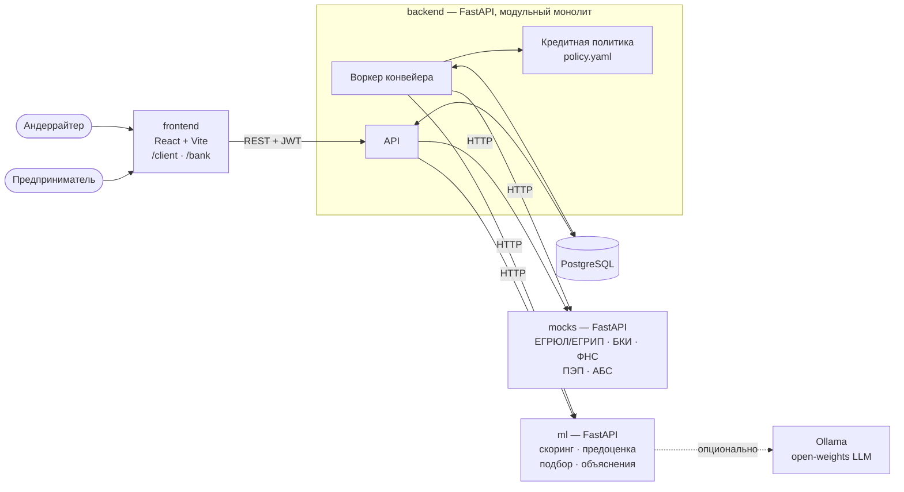
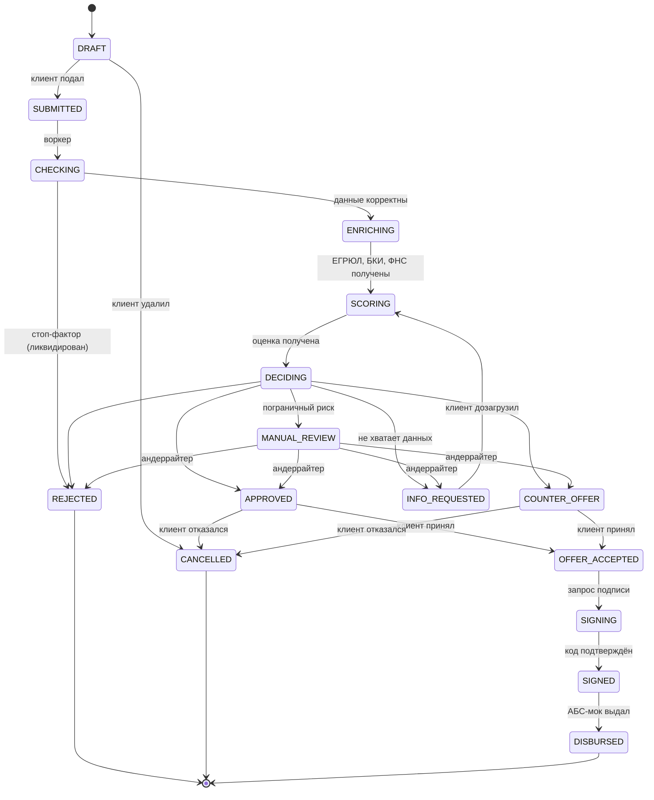
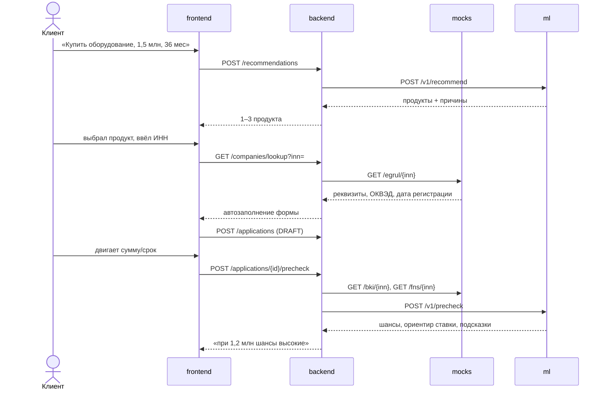
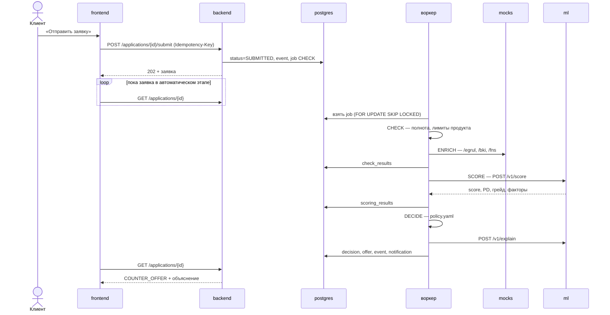
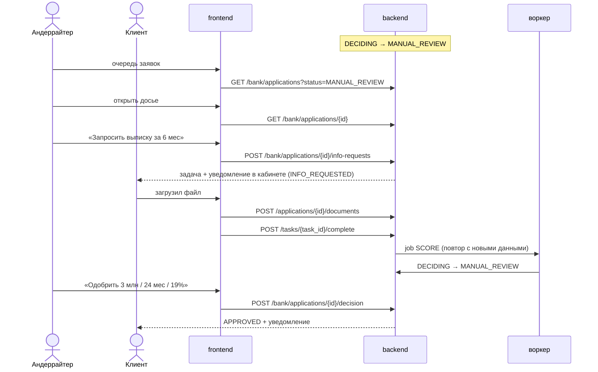
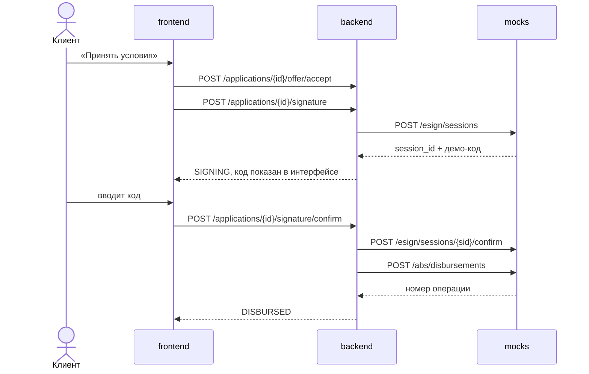
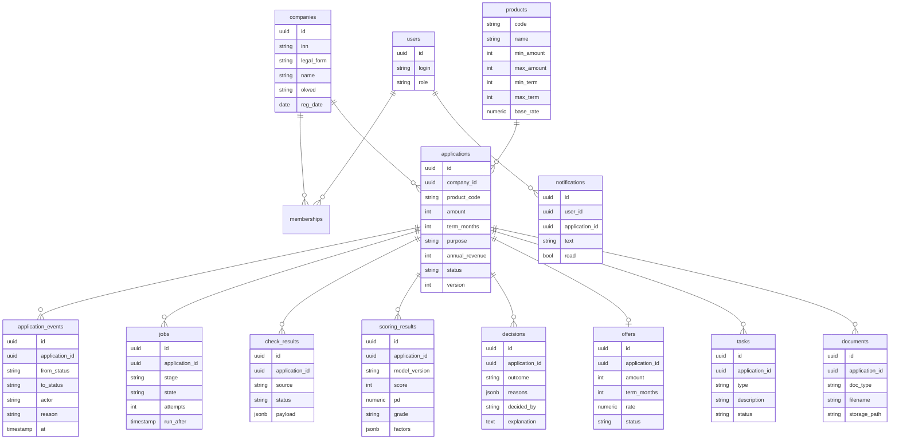

# Архитектура и взаимодействие компонентов

Смысл продукта — в [concept.md](concept.md), точные запросы и ответы — в [api-contract.md](api-contract.md).

## 1. Компоненты



| Сервис | Порт | Владелец | Отвечает за | Не делает |
|---|---|---|---|---|
| `frontend` | 3000 | Фронт | Два кабинета, состояния экранов | Не считает бизнес-решения |
| `backend` | 8000 | Бэк | Заявки, state machine, воркер, политика, роли, аудит, файлы | Не содержит ML-логику |
| `ml` | 8001 | ML | Скоринг, предоценка, подбор продукта, тексты объяснений | Не хранит состояние, не ходит в БД |
| `mocks` | 8002 | ML (помогает бэку) | Детерминированные ответы внешних систем по ИНН | Не знает о заявках |
| `postgres` | 5432 | Бэк | Все данные + очередь задач конвейера | — |
| `ollama` | 11434 | ML | LLM для объяснений (профиль `llm`) | Без него всё работает |

### Правила взаимодействия

1. **Фронт ходит только в `backend`.** В `ml` и `mocks` напрямую — никогда.
2. **`ml` и `mocks` — stateless.** Состояние живёт только в Postgres бэкенда.
3. **Скоринг ≠ решение.** `ml` возвращает оценку риска, итоговое решение принимает `backend` по `policy.yaml`.
4. **Любой вызов `ml` / `mocks`** — таймаут 3 с, до 3 ретраев с backoff. Если LLM недоступен, `ml` отдаёт шаблонный текст.
5. **Статус заявки меняет только state machine** в `backend`. Каждый переход пишется в `application_events`.
6. **Фронт узнаёт об изменениях опросом** `GET /applications/{id}` раз в 3 с, пока заявка в автоматическом этапе (SSE — улучшение, если будет время).

## 2. Жизненный цикл заявки



| Статус | Кто двигает дальше | Текст для клиента |
|---|---|---|
| `DRAFT` | Клиент | Черновик — заполните и отправьте |
| `SUBMITTED`, `CHECKING` | Воркер | Проверяем данные |
| `ENRICHING` | Воркер | Запрашиваем сведения о компании и кредитную историю |
| `SCORING`, `DECIDING` | Воркер | Оцениваем заявку |
| `MANUAL_REVIEW` | Андеррайтер | Заявку изучает специалист, обычно до 1 рабочего дня |
| `INFO_REQUESTED` | Клиент | Нужны документы — смотрите задачу |
| `APPROVED` / `COUNTER_OFFER` | Клиент | Одобрено / есть предложение — примите условия |
| `OFFER_ACCEPTED`, `SIGNING` | Клиент | Подпишите договор |
| `SIGNED` | Воркер | Перечисляем деньги |
| `DISBURSED` | — | Деньги на счёте |
| `REJECTED` | — | Отказ, причины и рекомендации |
| `CANCELLED` | — | Заявка отменена |

Недопустимый переход → `409 INVALID_TRANSITION`.

## 3. Сквозные сценарии

### 3.1. Подбор продукта и предоценка (до подачи, ничего не сохраняется кроме черновика)



### 3.2. Подача и автоматический конвейер



Каждый этап — отдельная запись в `jobs`. Если `mocks`/`ml` упали — job повторяется, статус заявки не теряется. Повтор этапа идемпотентен (ключ `application_id + stage + attempt_round`).

### 3.3. Ручное рассмотрение и дозапрос



### 3.4. Оффер, подписание, выдача



## 4. Модель данных



`applications.version` — оптимистическая блокировка: параллельные изменения одной заявки дают `409 CONFLICT`.

## 5. Кредитная политика (backend, `policy.yaml`)

Порядок применения:

1. **Стоп-факторы → `REJECTED`:** компания ликвидирована / банкротство; просрочка 90+ дней за 12 мес; налоговый долг выше порога.
2. **Нехватка данных → `INFO_REQUESTED`:** бизнесу < 6 мес без выписки; выручка не подтверждена для суммы выше порога.
3. **По грейду из `ml`:**

| Грейд | Сумма ≤ лимита | Сумма > лимита |
|---|---|---|
| A, B | `APPROVED` | `COUNTER_OFFER` (сумма = лимит) |
| C | `MANUAL_REVIEW` | `MANUAL_REVIEW` |
| D, E | `REJECTED` | `REJECTED` |

- Лимит = `min(product.max_amount, k(грейд) × annual_revenue, сумма при DSCR ≥ 1.3)`.
- Ставка = `product.base_rate + надбавка(грейд)`.
- Пороги и коэффициенты меняются в YAML без правки кода.

## 6. Роли и безопасность

| Роль | Доступ |
|---|---|
| `CLIENT` | Только заявки своих компаний (`/applications/*`) |
| `UNDERWRITER` | Все заявки на чтение, решения по `MANUAL_REVIEW` (`/bank/*`) |
| `ADMIN` | Справочники, сброс демо-данных |

- JWT (демо-пользователи из сидов), проверка роли на каждом эндпоинте.
- Pydantic-валидация всех входов, единый формат ошибок без внутренних деталей.
- Загружаемые файлы: whitelist типов, лимит 10 МБ, хранение в volume, а не в БД.
- Логи в JSON с `request_id`, без персональных данных; `/health` у каждого сервиса.
- Все данные синтетические; секреты только через `.env` (в Git — `.env.example`).

## 7. Структура репозитория

```
backend/    FastAPI: app/{api,domain,workflow,policy,integrations,db}, alembic, tests
ml/         service/ (FastAPI: score, precheck, recommend, explain)
            training/ (генератор синтетики, обучение, отчёт), artifacts/ (модель)
mocks/      FastAPI: egrul, bki, fns, esign, abs + data/personas.json
frontend/   React + Vite + TS: src/{client,bank,shared}
docs/       concept, architecture, api-contract, openapi.yaml, decisions
postman/    коллекция запросов
docker-compose.yml, .env.example, README.md, THIRD_PARTY_NOTICES.md
```
