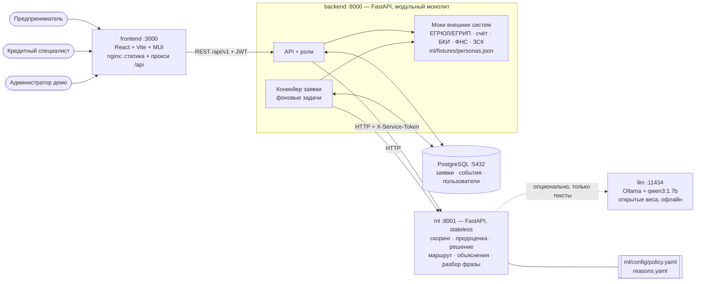
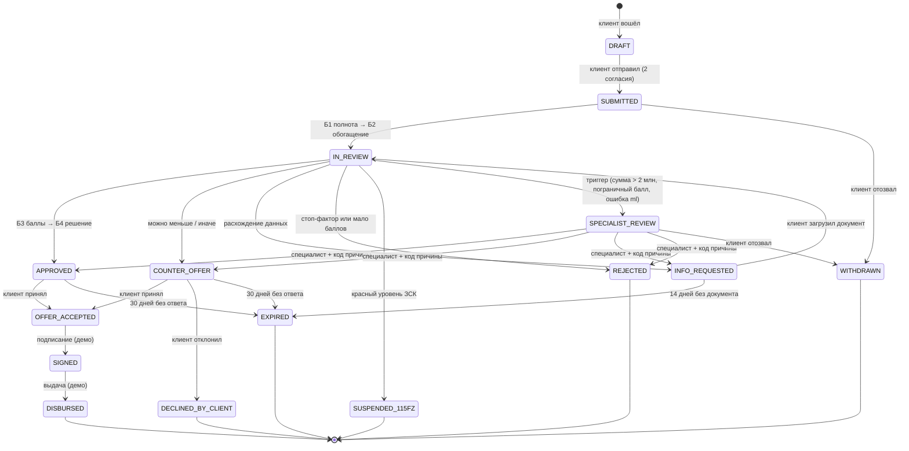
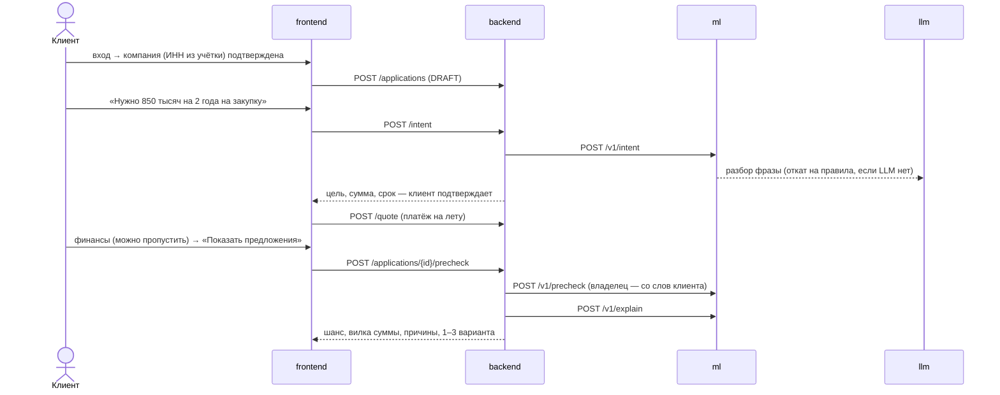
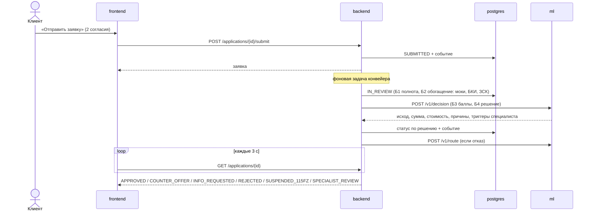
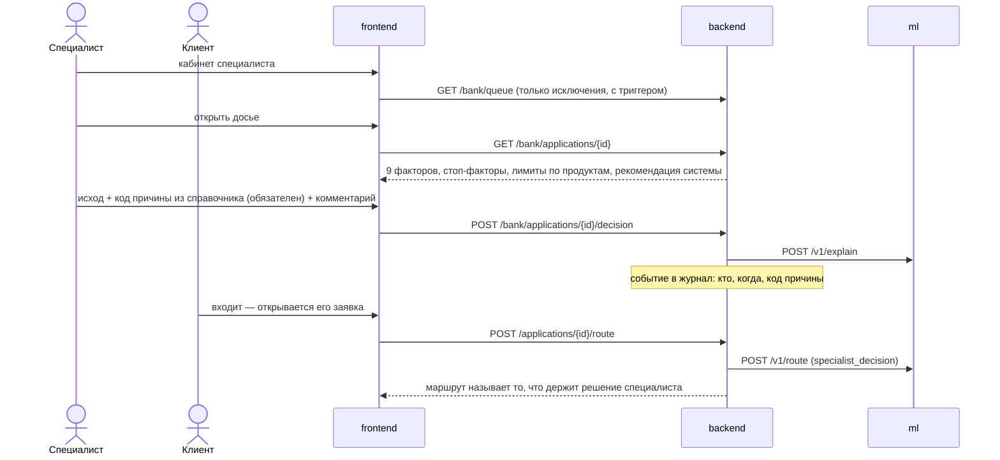
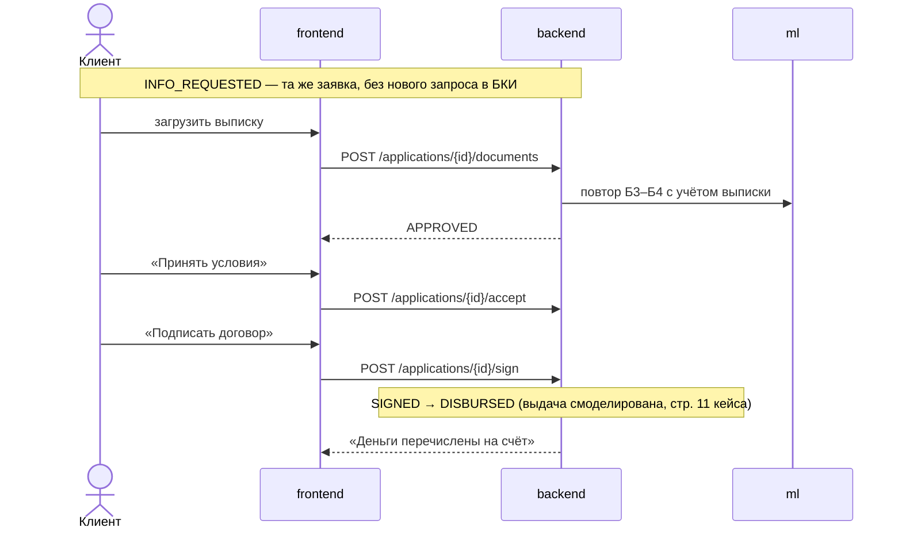
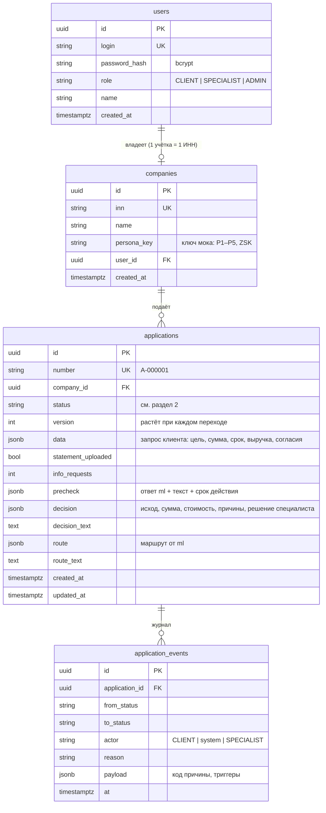

# Архитектура и взаимодействие компонентов

Документ описывает **реализованную** систему: то, что запускается `docker compose up`. Смысл продукта — в
[concept.md](concept.md), запросы и ответы — в [openapi-backend.json](openapi-backend.json) (backend) и
[openapi-ml.yaml](openapi-ml.yaml) (движок одобрения), коллекция запросов — [postman/](postman/).

## 1. Компоненты



| Сервис | Порт | Отвечает за | Не делает |
|---|---|---|---|
| `frontend` | 3000 | Три кабинета: клиент, специалист, администратор. nginx отдаёт статику и проксирует `/api` в backend | Не считает бизнес-решения |
| `backend` | 8000 | Пользователи и роли (JWT), заявки и их статусы, журнал событий, конвейер (Б1–Б4), загрузка документов, моки внешних систем | Не содержит кредитной логики: всё считает `ml` |
| `ml` | 8001 | Движок одобрения по `policy.yaml`: 9 факторов скоринга, стоп-факторы, лимиты продуктов, решение, причины, маршрут, тексты | Не хранит состояние, не ходит в БД, не меняет статусы |
| `postgres` | 5432 | Все данные | — |
| `llm` | 11434 | Пересказ посчитанных фактов человеческим языком, разбор свободной фразы клиента | Не принимает решений. Без LLM всё работает на шаблонах |

### Внешние системы — моки

Кейс запрещает обращаться к системам банка (стр. 10, «Автономность»), поэтому внешние источники смоделированы
детерминированными данными по каждой демо-компании в `ml/fixtures/personas.json`:

| Источник в реальном банке | Что берём из мока | Когда |
|---|---|---|
| ЕГРЮЛ / ЕГРИП | форма, ОКВЭД, возраст бизнеса | с момента входа |
| Счёт в банке (РКО) | обороты за 6 мес., срок обслуживания | до подачи |
| ФНС «Прозрачный бизнес», ФССП, арбитраж | налоговый долг, исполнительные производства | до подачи |
| БКИ | кредитная история владельца | **только после подачи и согласия** |
| ЗСК (115-ФЗ) | уровень риска | **только после подачи** |
| Подпись и выдача (АБС) | смоделированы сменой статуса | после принятия условий |

### Правила взаимодействия

1. **Фронт ходит только в `backend`.** В `ml` и `llm` напрямую — никогда.
2. **`ml` stateless.** Состояние живёт только в Postgres бэкенда.
3. **Скоринг ≠ решение, но модель одна.** Скоринг, решение, предоценка и маршрут считаются одним движком по одному
   `policy.yaml`. Поэтому один и тот же балл даёт разные лимиты по разным продуктам (P2: 72 балла → 2 850 000 ₽
   оборотного кредита и 760 000 ₽ овердрафта). Подробно — [decisions.md](decisions.md).
4. **Вызовы `ml`** — таймаут 5–20 с, до 3 попыток с паузой. Ошибка `ml` переводит заявку к специалисту, а не теряет её.
5. **Статус меняет только backend**, каждый переход пишется в `application_events` (кто, когда, откуда, куда, причина).
6. **Фронт узнаёт об изменениях опросом** `GET /applications/{id}` раз в 3 с, пока банк работает над заявкой.
7. **LLM только пересказывает.** Числа, исход и причины приходят из правил; текст 115-ФЗ всегда шаблонный.

## 2. Жизненный цикл заявки



| Статус | Кто двигает дальше | Что видит клиент | Маршрут |
|---|---|---|---|
| `DRAFT` | Клиент | Шаги заявки, предоценка | при низком/среднем шансе или сумме выше оценки |
| `SUBMITTED`, `IN_REVIEW` | Конвейер | Лента этапов, срок не обещается | — |
| `SPECIALIST_REVIEW` | Специалист | «Заявку рассматривает специалист» | — |
| `INFO_REQUESTED` | Клиент | Какой документ и до какой даты | — |
| `APPROVED` | Клиент | Сумма, платёж, полная стоимость | нет |
| `COUNTER_OFFER` | Клиент | «Хотели — можем», принять или отклонить | да: что держит сумму |
| `OFFER_ACCEPTED` → `SIGNED` → `DISBURSED` | Клиент → конвейер | Подписать → перечисляем → деньги на счёте | — |
| `REJECTED` | — | Причины простыми словами | да, в т.ч. от решения специалиста |
| `SUSPENDED_115FZ` | Клиент → Банк России | «Это не оценка кредитоспособности», шаблонный текст и порядок действий по 115-ФЗ со ссылками на cbr.ru | **нет**: это не кредитный отказ |
| `DECLINED_BY_CLIENT`, `WITHDRAWN`, `EXPIRED` | — | Итог и кнопка «Новая заявка» | — |

Действие не в своём статусе (например, подписать неодобренную заявку) → `409 Conflict`.

## 3. Сквозные сценарии

### 3.1. Предоценка до подачи (без БКИ)



### 3.2. Подача и автоматический конвейер



### 3.3. Специалист и маршрут от его решения



### 3.4. Дозапрос, принятие, подписание, выдача



## 4. Модель данных



Почему ответы движка лежат в `jsonb`, а не в отдельных таблицах: контракт `ml` развивается вместе с политикой, а
бэкенду важно сохранить ровно то, что показали клиенту и специалисту (аудит). Загруженные файлы хранятся в volume
`backend_uploads`, а не в БД.

## 5. Кредитная политика (`ml/config/policy.yaml`)

Одна модель для предоценки, решения и маршрута: порядок правил, 9 факторов (100 баллов), лимиты продуктов,
справочник причин (`reasons.yaml`) и шаги маршрута. Пороги и коэффициенты меняются в YAML без правки кода.
Подробно — [ml/README.md](../ml/README.md), проверка модели — [model-validation.md](model-validation.md).

## 6. Роли и безопасность

| Роль | Доступ |
|---|---|
| `CLIENT` | Только заявки своей компании (`/applications/*`, `/quote`, `/intent`) |
| `SPECIALIST` | Очередь исключений, досье, решения с кодом причины (`/bank/*`) |
| `ADMIN` | Все заявки, состояние сервисов, сброс демо-данных (`/admin/*`) |

- JWT с ролью, проверка роли на каждом эндпоинте; пароли — bcrypt.
- Pydantic-валидация всех входов; ошибки без внутренних деталей.
- Служебный токен `X-Service-Token` между backend и ml (включается переменной `ML_SERVICE_TOKEN`).
- `X-Request-ID` сквозь backend → ml, метрики Prometheus у ml (`/metrics`), `/health` у каждого сервиса.
- Все данные синтетические; секреты только через `.env` (в Git — `.env.example`).
- Контейнеры backend запускаются от непривилегированного пользователя.

### Что сделали бы для промышленной эксплуатации

| Сейчас (демо) | В банке |
|---|---|
| Конвейер — фоновые задачи FastAPI | Очередь задач (Kafka / RabbitMQ / таблица задач с `SKIP LOCKED`) с повторами по этапам |
| Моки из `personas.json` | Адаптеры к ЕГРЮЛ, БКИ, ФНС, ЗСК с тем же контрактом |
| Таблицы создаются при старте | Миграции Alembic |
| Опрос статуса раз в 3 с | SSE / WebSocket |

## 7. Структура репозитория

```
backend/    FastAPI: app/{api,schemas,services,db}, tests/, Dockerfile, uv.lock
ml/         service/ (движок одобрения), config/ (policy.yaml, reasons.yaml), fixtures/personas.json,
            eval/, tests/, Dockerfile, uv.lock
llm/        Ollama + вшитая модель qwen3:1.7b
frontend/   React + Vite + TS: src/{pages,components,utils}, nginx.conf, package-lock.json
docs/       architecture, concept, decisions, openapi-backend.json, openapi-ml.yaml, postman/,
            test-scenarios.md, test-user-maps.md
scripts/    smoke_api.py — сквозная проверка всех персонажей
docker-compose.yml, .env.example, README.md, THIRD_PARTY_NOTICES.md
```
