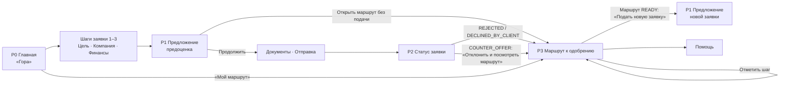

# Страницы маршрута к одобрению

Какие страницы видит клиент, в каком порядке они идут, откуда на них попадают и что на каждой должно быть.

> **Решение команды (24.10):** отдельной страницы маршрута нет. Р3 — панель «Маршрут к вершине» на главной (Р0 «Гора»): все ссылки на маршрут открывают главную с этой панелью, адрес `/route` тоже ведёт туда. На статусе заявки — только карточка «Следующий привал» с переходом на главную. Так маршрут остаётся там, где живёт образ горы, а экраны заявки не перегружаются. Документ дополняет [BPMN-процесс](team/bpmn/bpmn-description.md) (страница схемы «Маршрут») и [карты персон](test-user-maps.md). Статусы и коды — как в коде: `backend/app/schemas/applications.py`, `ml/service/route.py`, `ml/config/reasons.yaml`.

---

## 1. Порядок страниц

| № | Страница | Есть сейчас | Что меняется |
|---|---|---|---|
| Р0 | Главная кабинета «Гора» | Есть: альпинист на тропе, под горой три карточки (высота, вершина, варианты маршрута) и полоса «Условия пути»; стрелка «›» открывает панель «Мой маршрут» | Из панели и стрелки «›» добавляется переход «Открыть маршрут» на Р3 |
| Р1 | Шаг «Предложение» (предоценка) | Есть, блок «Что влияет на решение и как это исправить» | Добавляется кнопка «Открыть маршрут без подачи» |
| Р2 | Статус заявки | Есть: карточка «Следующий привал» — горизонт и кнопка «Маршрут на главной» | Карты и списка шагов на статусе нет |
| Р3 | **Маршрут к одобрению** | Есть: панель на главной (`frontend/src/components/RoutePanel.tsx`) | Разделы: где вы · что сделать (отметки и пересчёт) · ориентир · чего не делать · действия |
| — | Помощь | Есть | Подсказки-вопросы по маршруту |

---

## 2. Откуда ведут ссылки на маршрут

| Откуда | Элемент | Когда показывается | Куда |
|---|---|---|---|
| Р1 Предложение | Кнопка «Открыть маршрут без подачи» | Шанс не `HIGH` или сумма выше оценки (`needsRoute`). Для стоп-фактора — основная кнопка вместо «Продолжить» | Р3, маршрут по черновику, заявка не создаётся |
| Р2 Статус, `REJECTED` | Кнопка «Открыть маршрут» в блоке «Следующий привал» | Всегда при отказе, кроме постоянного стоп-фактора | Р3, маршрут от решения |
| Р2 Статус, `COUNTER_OFFER` | Кнопка «Отклонить и посмотреть маршрут» | Пока предложение действует | Статус `DECLINED_BY_CLIENT`, затем Р3 |
| Р2 Статус, `DECLINED_BY_CLIENT` | Кнопка «Открыть маршрут» | Всегда | Р3 |
| Р0 Главная | Карточка «Варианты маршрута» → «›» → «Открыть маршрут» | Есть сохранённый маршрут у последней заявки | Р3 |
| Меню «Мои заявки» | Ссылка «Маршрут» в карточке заявки | У заявки есть маршрут | Р3 этой заявки |

**Где ссылки на маршрут нет:**
- `APPROVED`, `OFFER_ACCEPTED`, `SIGNED`, `DISBURSED`: ограничений нет.
- `INFO_REQUESTED`: вместо маршрута «что загрузить и до какого срока».
- `SUSPENDED_115FZ`: некредитная причина. Вместо маршрута — блок «Что делать дальше · процедура 115-ФЗ».
- `WITHDRAWN`, `EXPIRED`: решения банка не было.
- `SUBMITTED`, `IN_REVIEW`, `SPECIALIST_REVIEW`: решение ещё не принято.

---

## 3. Р3 «Маршрут к одобрению» — что в панели на главной

Карта-гора — это сама главная: альпинист на тропе, высота и вершина. Панель справа содержит разделы ниже, кроме карты.

Сверху вниз.

| Блок | Что показывает | Данные |
|---|---|---|
| 1. Шапка | Заголовок «Маршрут к одобрению», номер заявки, основание: «по предварительной оценке», «по решению банка» или «по решению специалиста банка» | `basedOn`: `SYSTEM` / `SPECIALIST`; черновик или поданная заявка |
| 2. Карта-гора | Текущая высота — сумма, доступная сейчас. Вершина — запрошенная сумма. Привалы — шаги маршрута. Подпись препятствия по тому, что держит результат | Текущая высота: решение банка, а для черновика — верх вилки предоценки. Вершина: запрошенная сумма. Препятствие: `holds` |
| 3. Что мешает | Причины простыми словами, первая — главная, с цветом: 🟢 можно сразу · 🟡 нужно время · 🔴 стоп-фактор | Причины решения или предоценки, тексты из `reasons.yaml` |
| 4. Следующий привал | Горизонт: «~3 мес.», «~8 мес., ускорить нельзя», «срок зависит от темпа роста оборота» | `horizonText`, `message` |
| 5. Шаги | Список с отметками: действие, срок, цвет, вклад в баллы. У шагов, которые меняют кредитную историю, — пометка «бюро обновит данные за 2 рабочих дня». У шага по обороту — целевой оборот в месяц | `steps[]`: `action`, `term`, `pointsGain`, `done`, `bkiDelayBusinessDays`, `targetTurnover` |
| 6. Прогноз | Что будет после всех шагов: доступная сумма и ожидаемый исход | `projectedAmount` |
| 7. Чего не делать | Предупреждения, например «Не подавайте заявки в другие банки…» | `advice[]` |
| 8. Подпись | Дословно: «Это ориентир при текущем темпе, а не обещание одобрения.» | `disclaimer` |
| 9. Действия | «Подать новую заявку» — только при `READY`. «Спросить помощника» — всегда | `status` |

**Поведение:**
- Отметка шага сразу пересчитывает маршрут. Выполненные шаги остаются зачёркнутыми, горизонт, прогноз и положение на карте обновляются.
- Пересчёт не создаёт заявку и не обращается в бюро кредитных историй.
- Маршрут и отметки сохраняются. При следующем входе клиент видит свой прогресс.

---

## 4. Варианты Р3 по тому, что держит результат

| `holds` | Пример | Что на странице |
|---|---|---|
| `STOP` | P3, налоговый долг | Стоп-фактор — первый шаг, вклад «+0, без него маршрут не двигается». Дальше шаги с баллами. Горизонт «~3 мес.» |
| `SCORE` | Не хватает баллов без стопов | Шаги с вкладом в баллы, прогноз баллов и суммы |
| `TURNOVER` | P2 после отказа от иных условий | Один шаг «рост оборота до 2 000 000 ₽ в месяц» и пометка «баллы уже не мешают — сумму держит оборот» |
| `TIME_WINDOW` | P4, просрочка 90+ за 12 месяцев | «~8 мес., ускорить нельзя». Шаг «дождаться» без отметки, затем что делать сейчас и чего не делать. Без игровых элементов и анимации — в том числе альпинист на главной не анимируется и стоит у подножия |
| `STOP_PERMANENT` | Ликвидация, банкротство, запрещённая отрасль | Маршрута к этому продукту нет, причина и ближайшая альтернатива. Кнопки «Подать новую заявку» нет |
| `NONE` | Маршрут дошёл до цели | Статус `READY`, «Можно подавать заявку» |
| `NONCREDIT` | ZSK, 115-ФЗ | На Р3 не попадают: ссылки нет. Статус маршрута `NO_ROUTE` |

---

## 5. Состояния маршрута

| Статус маршрута | Когда | Что видит клиент |
|---|---|---|
| `ACTIVE` | Маршрут построен, порог не достигнут | Шаги, отметки, пересчёт. Кнопки новой заявки нет |
| `READY` | Нет стоп-факторов, 70+ баллов, лимит не меньше выбранной суммы | «Готов к подаче» и кнопка «Подать новую заявку»: новый черновик с данными маршрута открывается на шаге «Предложение» |
| `NO_ROUTE` | 115-ФЗ | Страница не открывается, на статусе — процедура 115-ФЗ |

---

## 6. Маршрут без подачи — отличия

| | Без подачи (из Р1) | После решения (из Р2) |
|---|---|---|
| Заявка | Остаётся черновиком `DRAFT` | Есть решение: `REJECTED` или `DECLINED_BY_CLIENT` |
| Данные о владельце | Со слов клиента. Пометка «кредитную историю проверим после подачи» | Данные бюро кредитных историй |
| Запрос в бюро | Нет | Был при подаче |
| Основание в шапке | «По предварительной оценке» | «По решению банка» или «По решению специалиста банка» |

Реализовано: для черновика `POST /applications/{id}/route` собирает данные как для предоценки (`route_stage` → `PRECHECK`: ответы клиента, без бюро и ЗСК). При новой предоценке и при подаче маршрут черновика сбрасывается и после решения строится заново. Выполненные шаги сохраняются в маршруте и видны при следующем входе.

---

## 7. Связь с персонами

| Персона | Путь по страницам |
|---|---|
| P1 | Р1 → Отправка → Р2 `APPROVED`. Маршрута нет |
| P2 | Р1 → Отправка → Р2 `SPECIALIST_REVIEW` → `COUNTER_OFFER` → «Отклонить и посмотреть маршрут» → Р3 `TURNOVER` |
| P3 | Р1 «низкий» → «Открыть маршрут без подачи» → Р3 `STOP`; или подача → Р2 `REJECTED` → Р3. Отметка шагов → `READY` → новая заявка |
| P4 | Р1 «средний» по словам клиента → Отправка → Р2 `REJECTED` → Р3 `TIME_WINDOW` |
| P5 | Р2 `INFO_REQUESTED` → загрузка выписки → `APPROVED`. Маршрута нет |
| ZSK | Р2 `SUSPENDED_115FZ` → процедура 115-ФЗ. Маршрута нет |

---

## 8. Статистика продукта

Идея: показывать эффект продукта — долю одобрений, время подачи, долю вернувшихся по маршруту.

**Где показываем.** В кабинете администратора банка (FR-20 «Дашборд воронки и причин отказов», Should), а не клиенту на главной. Это аргумент для банка и жюри: «вот что продукт меняет в процессе».

**Чего не делаем.**
- Не показываем клиенту рекламные цифры вида «с нами одобряют на X% чаще» или «быстрее на Y%». На синтетических данных такие числа ничего не доказывают, а спецификация прямо запрещает обещать одобрение и скорость решения банка (раздел 12). Жюри-банкиры увидят это сразу.
- Не выбираем цифры «если они нас устраивают». Метрика считается по всем заявкам одинаково, иначе это подгонка.

**Что считаем — только из событий в базе** (таблица `application_events`, статусы и время):

| Метрика | Как считается | Зачем банку |
|---|---|---|
| Воронка | Черновики → поданные → решения → выданные | Где теряются клиенты |
| Исходы | Доли одобрено / иные условия / нужны данные / отказ / 115-ФЗ | Структура решений |
| Доля автоматических решений | Решения без специалиста / все решения | Снижение ручной работы |
| Время заполнения | Медиана от создания черновика до подачи | Проверка гипотезы «около 5 минут» |
| Время до решения | Медиана от подачи до решения | Скорость процесса |
| Топ причин отказа | Частота кодов причин в решениях | Что чаще всего мешает клиентам |
| Возврат по маршруту | Доля отказников, у которых маршрут дошёл до `READY` или есть новая заявка | Удержание клиента после отказа |
| Предоценка ↔ решение | Доля заявок, где ожидаемый исход предоценки совпал с решением | Честность предоценки |

На экране — подпись: «Данные демо-стенда, синтетические заявки». Клиенту на главной из этого блока можно показывать одну проверяемую фразу, например «Заявку обычно заполняют за N минут», только когда N посчитано по реальным событиям.
