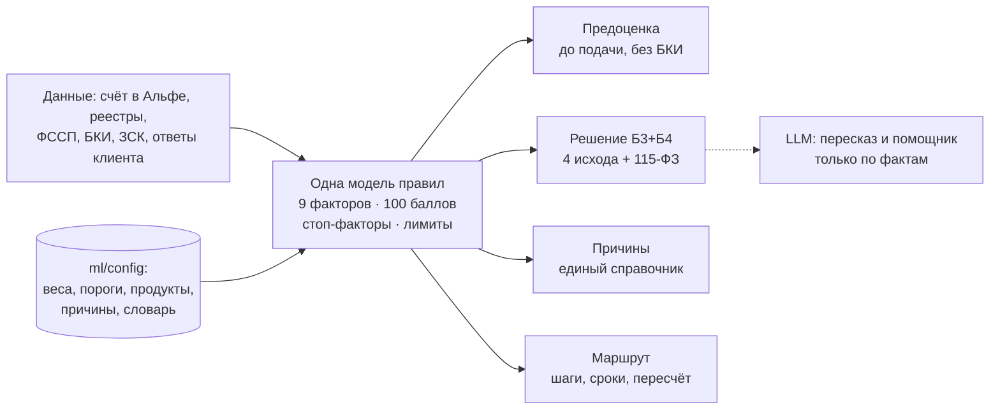

# ML для README и питча — готовые куски

> Рабочие материалы команды, не часть сдачи. Для проверки — корневой README, раздел «Для жюри».

Цифры ниже совпадают с кодом: их проверяют тесты `ml/tests/test_personas.py`, `test_weather.py`, `test_docs_consistency.py`.

## Одна модель — четыре результата

Скоринг ≠ решение: одинаковые баллы дают разные условия для разных продуктов. У P2 при 72 баллах оборотный кредит — до
2 850 000 ₽, овердрафт — до 760 000 ₽.

## 9 факторов

| Слой | Фактор | Баллы |
|---|---|---|
| Бизнес (75) | Регулярность оборотов | 20 |
| | Долговая нагрузка | 15 |
| | Возраст бизнеса | 10 |
| | Сумма относительно оборота | 10 |
| | Отрасль | 8 |
| | Суды и ФССП | 7 |
| | Срок обслуживания счёта | 5 |
| Владелец (25) | Кредитная история | 15 |
| | Личная долговая нагрузка | 10 |

## Как оценка превращается в решение (по порядку)

1. Красный уровень ЗСК или меры 115-ФЗ → **приостановлена по 115-ФЗ** (не кредитная причина, маршрута нет).
2. Нет документа или заявлено больше выручки, чем видно по счёту, на 30%+ → **нужны данные**.
3. Стоп-фактор (налоговый долг > 500 ₽, просрочка 90+ за 12 мес., текущая просрочка, банкротство и др.) → **отказ**.
4. 70+ баллов и лимит покрывает сумму → **одобрено**.
5. 70+ баллов, но лимит меньше, или 50–69 баллов (меньшая сумма и ставка выше на 2–4 п.п.) → **иные условия**.
6. Меньше 50 баллов → **отказ**.

К специалисту: сумма больше 2 млн, баллы 50–59, расхождение не устранено, клиент оспорил причину.

## Сценарии

| Персона | Результат |
|---|---|
| P1 Ольга | 100 баллов → одобрено 850 000 ₽ / 24 мес., 43 261 ₽ в месяц, полная стоимость 196 774 ₽ |
| P2 «Полка» | 72 балла → специалист → иные условия 2 850 000 ₽, 184 575 ₽ в месяц; сумму держит оборот |
| P3 Тимур | отказ: налоговая задолженность; маршрут: погасить ЕНС → закрыть кредитки (+8) → вся выручка через счёт (+12), ~3 мес. → 77 баллов, 1,1 млн |
| P4 Марина | отказ: просрочка 90+ за 12 мес.; «~8 мес., ускорить нельзя» |
| P5 Андрей | нужны данные (выписка второго банка) → одобрен овердрафт 300 000 ₽, 5 425 ₽ в месяц при полном использовании |
| ЗСК | приостановлена по 115-ФЗ, маршрута нет |

## «Погода» — что будет со стоимостью (P1)

| Сценарий | Платёж в месяц | Полная стоимость |
|---|---|---|
| Сейчас (20%) | 43 261 ₽ | 196 774 ₽ |
| Ставка выше на 2 п.п. | 44 096 ₽ | 216 814 ₽ |
| Задержать платёж на 30 дней | 43 261 ₽ | 198 072 ₽ + запись в кредитной истории |

«Это иллюстрация рисков, а не условия банка». На решение не влияет.

## ИИ: где помогает и чего не делает никогда

Локальная модель с открытыми весами (Qwen3 1.7B), работает без видеокарты и без интернета после первой загрузки.

| Помогает | Никогда не делает |
|---|---|
| Понимает задачу из фразы («нужно 800 тыс. на закупку к сезону») — клиент подтверждает поля | Не принимает и не меняет решение, баллы, суммы, сроки |
| Пересказывает причины и шаги маршрута простым языком | Не называет чисел и причин, которых нет в решении |
| Отвечает на вопросы при отказе и нехватке: почему, что делать, когда, что значит термин | Не обещает одобрение и не пишет «одобрено» вне решения |
| | Не пишет ничего о 115-ФЗ — только фиксированный текст |

Каждый ответ модели проверяется; не прошёл проверку или модель недоступна — показывается шаблон, сценарий не ломается.
